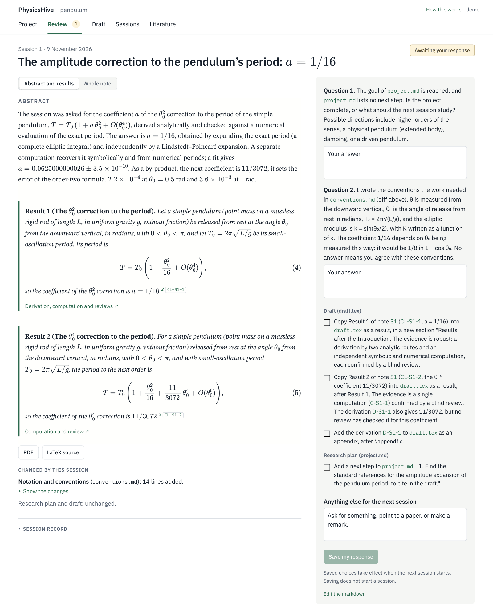
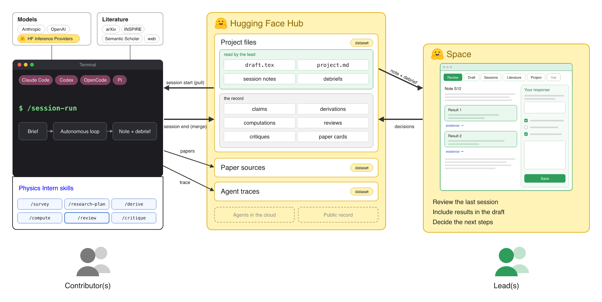
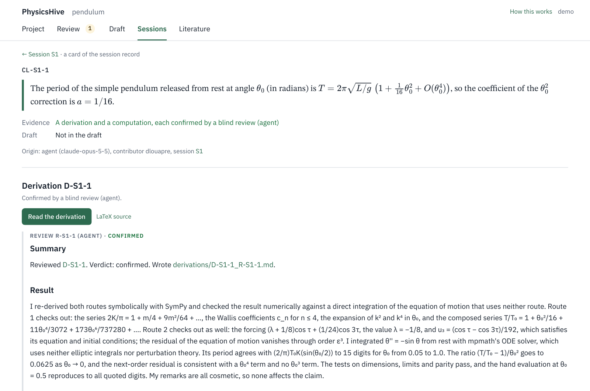

# PhysicsHive

PhysicsHive lets a small team of scientists steer AI coding agents (Claude Code, Codex CLI, OpenCode, Pi) on one problem in theoretical physics or mathematics. The agents work on their own in sessions of up to a few hours; each session comes back with a short LaTeX note and a one-page debrief, which the team reads and answers in a browser. A project lives in a *shared space*: private repositories on the Hugging Face Hub that hold its files and a complete record, which keeps every result checkable and traceable. *The Space* is the shared space's web app, where the notes are read and the debriefs answered.

Each person on a project is a lead, a contributor, or both. A **lead** sets the question, reads the notes, answers the debriefs and decides what enters the project's draft paper. A **contributor** runs the sessions in a terminal, with a coding agent. The format is built for several people, but so far PhysicsHive has been used by one person at a time, who was both the lead and the contributor.

<p align="center"><a href="examples/pendulum/"></a></p>

The page of a session in the Space, the web app where the leads work, on [the example in this repository](examples/pendulum/). On the left is the note that session 1 wrote, cut to its abstract and its result; on the right, the lead's response: an answer to the session's question, the lines ticked for the next session to apply, and a note.


## How the work goes

The work is organised the way a theoretical physicist works with a student.

1. The lead sets the question and the goal in `project.md`, and the next steps.
2. A contributor runs `/session-run` in a terminal. The session proposes a brief, by default the first next step; once it is confirmed, it works on its own within a budget of sub-agent dispatches (20 by default). It reads the literature, derives and computes in sub-agents that start from a fresh context, has every derivation and computation reviewed blindly, and records its results as small files called cards.
3. The session returns a LaTeX note of two to four pages, written for a reader who was not there, and a one-page debrief: a few questions, and lines to tick, each a concrete change to the lead's files (`project.md`, `conventions.md`, `draft.tex`).
4. The lead reads the note and answers the debrief in the Space: writes under each question, ticks the lines they accept, and adds anything else in a note box.
5. The next session starts from these answers: it applies the ticked lines before anything else.
6. A shared LaTeX draft, `draft.tex`, holds what the leads decide to keep. A result counts as established only once the draft names it.
7. The record behind these few files (cards, derivations, computations, reviews, logs, traces) keeps every step checkable and traceable: for every result, who produced it (which agent and model, or which person), how, and with which version of the method. The leads are never asked to read it; notes and the draft link into it.

<p align="center"></p>

The figure shows the same cycle. On the left, a contributor runs a session in a terminal, whose sub-agents use skills that PhysicsHive inherited from Physics Intern; in the middle, the shared space on the Hub holds the lead's files and the record; on the right, a lead answers in the Space. Dashed boxes are not built yet.

A space stays private while the research is done. The record is kept so that, at the end of a project, it can be published with the results; there is no publishing step yet (see [ROADMAP.md](ROADMAP.md)). A local workspace, on one machine without the Hub, keeps the same record but no agent traces: traces are exported only in a shared space.


## What two sessions produce

[`examples/pendulum/`](examples/pendulum/) is a real shared space after two sessions, copied from the Hub, made with version 0.6.0 of the method. The question is small on purpose, a textbook result, so that the output is easy to judge: the period of a pendulum to second order in the amplitude ([`project.md`](examples/pendulum/project.md)). Both sessions ran with Claude Code (model `claude-opus-5-5`); no cost was recorded (see [the FAQ](docs/faq.md#what-does-it-cost-to-run)).

- Session S1 took about 20 minutes and used 5 of the 20 dispatches its brief allowed. Its note, [`sessions/S1/note.pdf`](examples/pendulum/sessions/S1/note.pdf), gives the coefficient c₂ = 1/16, obtained by two analytic routes and checked numerically, with the next coefficient, 11/3072, as context. Behind it are a claim card in [`claims/`](examples/pendulum/claims/), a derivation in [`derivations/`](examples/pendulum/derivations/) and a computation in [`computations/`](examples/pendulum/computations/), each with its blind review, and a critique of the whole.
- The lead answered its debrief, [`sessions/S1/debrief.md`](examples/pendulum/sessions/S1/debrief.md): two lines ticked in the Space, to copy the result into the draft and to run a short literature survey next, and, at the start of S2, the answer "survey only, then stop" to its question.
- Session S2 applied the ticked lines first, so the draft, [`draft.pdf`](examples/pendulum/draft.pdf), now holds the result, which makes it established. It then ran the survey with 1 of the 3 dispatches its brief allowed and wrote two paper cards; one of them, Lima and Arun (2006), states the formula. The session took about 13 minutes. Its debrief, [`sessions/S2/debrief.md`](examples/pendulum/sessions/S2/debrief.md), offers one line to tick, a sentence that cites this paper after the result in the draft, and waits for the lead.

Every result leads to its evidence. In the Space, the link under Result 1 of the note opens the page of its claim card:

<p align="center"></p>

[`examples/README.md`](examples/README.md) says what each file of the example is.


## Quick start

You need:

- **git** and **[uv](https://docs.astral.sh/uv/)**, which runs the scripts with their dependencies (the installer offers to install uv);
- at least one *harness*, the command-line program of a coding agent, installed and logged in: **[Claude Code](https://claude.com/claude-code)**, **[Codex CLI](https://github.com/openai/codex)**, **[OpenCode](https://opencode.ai)** or **[Pi](https://pi.dev)**;
- for a shared space, a Hugging Face account and an organisation for the team (or your own account, to try alone). A local workspace needs no account.

In an empty folder:

```bash
curl -LsSf https://raw.githubusercontent.com/scienceetonnante/physics-hive/master/install.sh | sh
```

The installer downloads the latest release and asks a few questions: create a shared space (the default), join one, or start a local workspace; which harnesses you use; for a new space, the owner and the name; and the question and the goal of the project. Nothing stays installed: the workspace keeps its own copy of the method. Then:

1. If you left the question or the goal for later, write them in the Space, on the *Project* page. The installer prints the Space's address.
2. Launch your harness in the workspace folder (`claude`, `codex`, `opencode` or `pi`), after the setup [below](#setting-up-your-harness).
3. Run **`/session-run`** (in Codex, `$session-run`), and confirm or adjust the brief it proposes. The session then works on its own until it stops, writes its note and its debrief, and merges its work into the space.
4. In the Space, read the note and answer the debrief on the *Review* page. Run `/session-run` again: the next session starts from your answers.

**Without a Hugging Face account.** A local workspace is a git repository on your machine, without the Hub. Sessions work the same way; you answer the debrief in your editor, or in the Space run on your machine (`uv run .physics-hive/scripts/serve.py` inside the workspace). A local workspace keeps no agent traces and no token counts, and there is no command that turns it into a shared space later.

```bash
curl -LsSf https://raw.githubusercontent.com/scienceetonnante/physics-hive/master/install.sh | sh -s -- --mode local
```

**The example in the Space, on your machine.** From a clone of this repository:

```bash
git clone https://github.com/scienceetonnante/physics-hive && cd physics-hive
uv run scripts/serve.py --dir examples/pendulum --read-only
```

`--read-only` keeps the example as it is: without it, saving the response form writes into the example's files.

https://huggingface.co/spaces/dlouapre/physics-hive-demo

[Getting started](docs/getting-started.md) takes you through the first session step by step.


## Setting up your harness

A session runs on its own for a long time, so set up your harness before the first one. [Setting up your harness](docs/harness-setup.md) covers each harness. Three steps matter most:

- **Claude Code**, with its sandbox on: the scripts run through uv, which writes its cache outside the workspace, so add this to `~/.claude/settings.json` (merged with your existing settings). Without it, no workspace script can run, and uv stops with "Failed to initialize cache".

  ```json
  { "sandbox": { "filesystem": { "allowWrite": ["~/.cache/uv"] } } }
  ```

- **Claude Code**: before `/session-run`, choose a permission mode in which Claude Code edits files without asking, auto mode or accept-edits mode (Shift+Tab cycles the modes). The workspace's settings allow its scripts and a few git commands, but no file edits, so in the default mode Claude Code asks before each edit and the session waits for you.
- **Claude Code and Codex CLI**: accept the trust prompt for the folder on first launch, so that the workspace's settings apply.


## Guides

- [Getting started](docs/getting-started.md): the first session, in a local workspace and in a shared space, step by step.
- [Shared spaces](docs/shared-spaces.md): create and join a space, what a session does on the Hub, the Space's token, editing files outside the Space, upgrades.
- [The Space](docs/the-space.md): the web app, page by page, and how to run it on your machine.
- [Setting up your harness](docs/harness-setup.md): what to do once for Claude Code, Codex CLI, OpenCode and Pi.
- [The workspace](docs/workspace.md): the lead's files, how decisions flow, what "established" means, the record and its cards, the skills and the scripts.
- [Questions and answers](docs/faq.md): models, privacy, costs, other fields, failing scripts.
- [DOCUMENTATION.md](DOCUMENTATION.md): the developer reference (render pipeline, workspace format, scripts, the Hub, the Space, tests, releases).
- [ROADMAP.md](ROADMAP.md): open directions and known limitations.
- [`design/DESIGN-shared-spaces.md`](design/DESIGN-shared-spaces.md): the design of the workspace format and of shared spaces.


## Status and limits

PhysicsHive is a research prototype. Its author has used it on a few problems, always as one person who was both the lead and the contributor. Its limits today:

- **Several people.** The format is built for several leads and contributors: colleagues can sign in to a space and write in its debriefs, and a second contributor can join it. Nobody has worked this way yet, and two parts still assume one person: a debrief has one answer per question, and two sessions that edit the same file at the same time (`draft.tex`, `conventions.md`, `literature/overview.md`) conflict when they merge.
- **Agents run only on the contributor's machine.** The harness runs there for the whole session, so that machine must stay on and connected.
- **Reviewers.** Model diversity between authors and reviewers is not enforced. Every card and trace records the models used, and the reviewer benchmark ([`bench/reviewer/`](bench/reviewer/README.md)) measures how often a reviewer configuration catches planted errors and raises false alarms.
- **Traces.** Trace export is complete for Claude Code and OpenCode, and best effort for Codex and Pi.
- **Publishing.** There is no step that makes the record public at the end of a project.
- Workspaces created with Physics Intern are not supported.

[ROADMAP.md](ROADMAP.md) gives each of these with enough context to work on it.


## Origin, licence, citation, contributing

PhysicsHive grew out of [Physics Intern](https://github.com/huggingface/physics-intern), in which agents work without anyone steering them: a problem goes in and an answer comes out. Physics Intern remains the tool for such autonomous runs; PhysicsHive is for research that people steer.

PhysicsHive is released under the Apache License 2.0 ([LICENSE](LICENSE)). To cite it, use the metadata in [CITATION.cff](CITATION.cff) (GitHub shows it under *Cite this repository*).

To work on PhysicsHive, read [CONTRIBUTING.md](CONTRIBUTING.md), then [DOCUMENTATION.md](DOCUMENTATION.md) and [ROADMAP.md](ROADMAP.md). [SECURITY.md](SECURITY.md) says what a shared space trusts and how to report a security problem.
