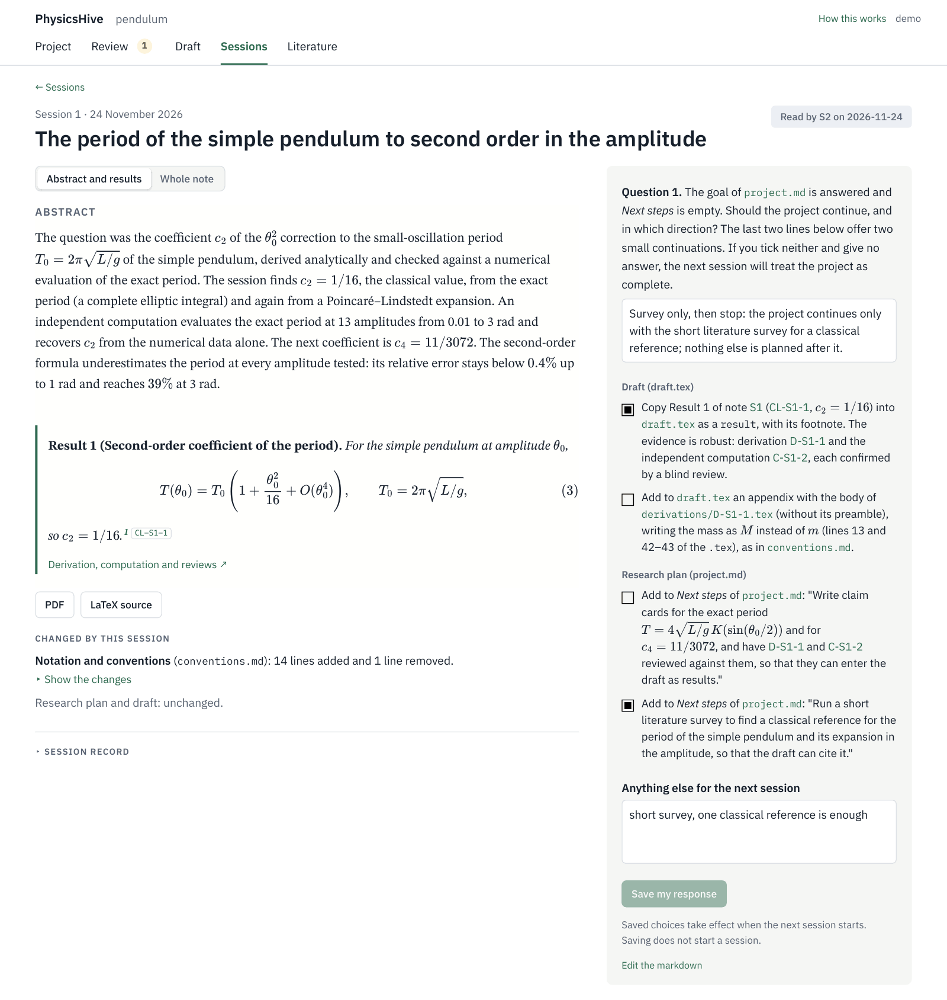
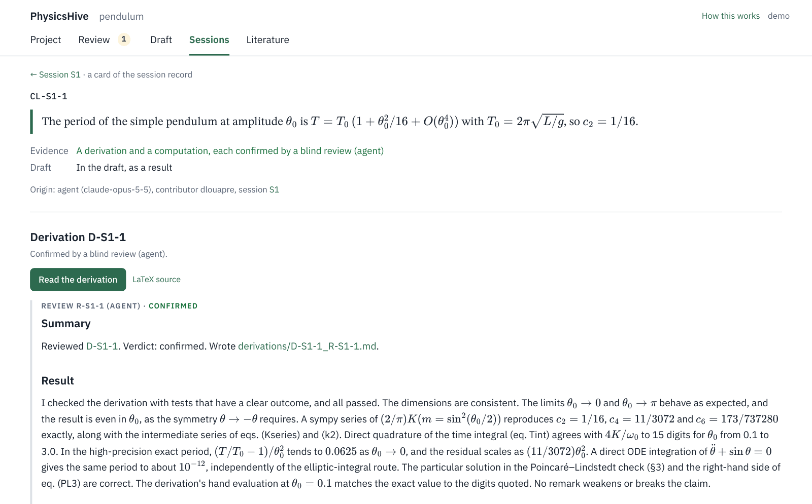
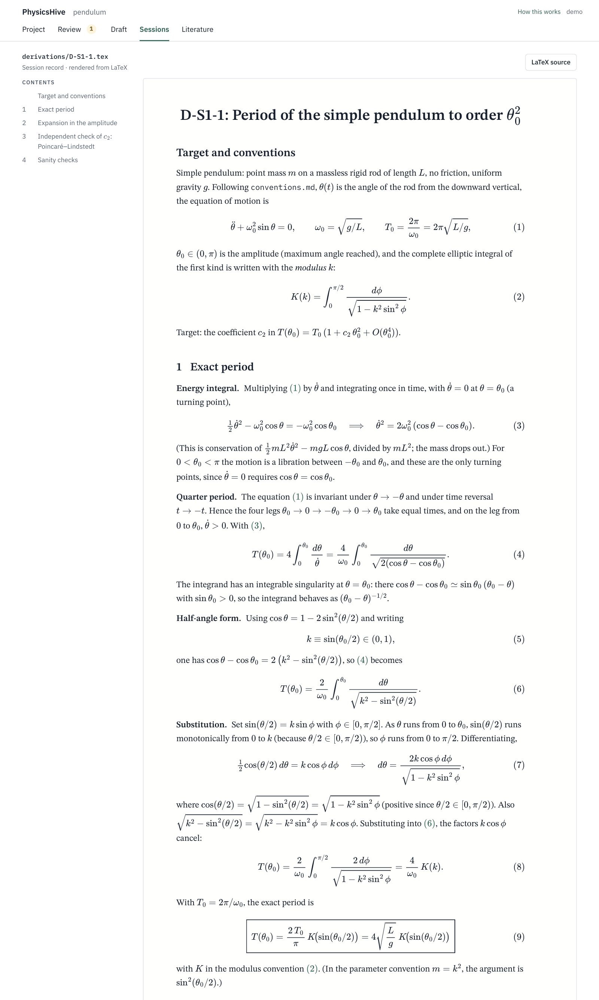

# The Space

The Space is the web app of a project: the place where the leads read what the sessions found and answer them, in a browser. In a shared space it runs as a private Hugging Face Space next to the workspace; for a local workspace, or to look at the example, it runs on your machine. This guide describes it page by page. Its images show the Space on the example in [`examples/pendulum/`](../examples/pendulum/); they are rendered from the app's real HTML and CSS, not captured in a browser, so small differences from a browser are possible.

The Space shows the lead's files, rendered, each with an editor where they may write. Saving commits the file to `main` on the Hub, with the Space's token, and names you in the commit. **The Space applies nothing**: it does not merge, copy or change anything on its own. The lines you tick are applied by the next session.


## Opening it and signing in

`create` prints the Space's own address, such as `https://our-lab-physics-hive-x-correction.hf.space`. Open the Space there and sign in with your Hugging Face account. On huggingface.co the Space is shown inside a frame, where browsers may block the sign-in; if that happens, use the *Open in a full page* link or the Space's own address.

The Space is private, so only members of the organisation that owns it can open it. Anyone who can sign in may write.

The header shows *PhysicsHive* and the project's name, a link *How this works*, your user name, and the tabs *Project*, *Review*, *Draft*, *Sessions* and *Literature*. The count on the *Review* tab is the number of debriefs awaiting your response. The browser tab's title names the page, the project and PhysicsHive (for example *Session 1 · pendulum · PhysicsHive*). At the bottom of each page, *Load the latest version* fetches `main` from the Hub; the Space also fetches it on a page view when its copy is more than two minutes old, and after each save.

*How this works* (`/help`) explains, in one page, the two roles (on that page, "you" means the lead), the cycle of sessions, what each page is for, and what "established" means.

A page that does not exist, or a problem that keeps the Space from reading the workspace, shows a short page that says what happened, with a link back to *Review*.


## Review

The page the Space opens on. It shows the page of the newest session whose debrief is open, that is, not yet read by a later session, and points to the other open ones. When no debrief is open, it says so and points to the newest one, which you can still add to: the next session receives whatever changes. A session that is running now is announced at the top; its note and debrief appear when it ends. Before the first session, the page says what it will show and what to write before running `/session-run`.


## A session's page

Each session has one page, reached from *Review* and from *Sessions*. It shows the session at three depths: what to read, what to decide, and how to check.

<p align="center"></p>

**On the left, the note.** It is headed by *Session n · date*, the note's title and the session's state. A switch above it shows either *Abstract and results* (the default) or the *Whole note*; the PDF and the LaTeX source are below it. Under each result, a link to the evidence of its card says what you will find there, for example *Derivation, computation and reviews*. A warning shows when a card is refuted, revised, or needs a re-check because a card it depends on was refuted or revised.

**Below the note:**

- *Other cards from this session*: the session's cards that no result of the note names;
- *Changed by this session*: one line for each of the lead's files that the session changed, with its line counts and, when it applied ticked lines, the debrief they came from; the diff is folded;
- the session record, folded: the debrief as the session wrote it, the coordinator's log, the pull request, the trace, what the session received, its brief, its artefacts and critiques.

**On the right, your response**, in a panel that stays in view: the questions, each with a text box; the lines to tick, grouped by the file they change (the draft, `project.md`, `conventions.md`, or *Other*); a note box for anything else; and *Save my response*. Links in a session's page open in a new tab, so that an answer you are writing stays in place.

A session's state is *Running now* while it runs; then *Awaiting your response* until you answer, tick or write a note; then *Answered, waiting for the next session*; then *Read by S<m>* once a later session has started and read it.

A session without a note (one that was stopped before writing it) shows the debrief's summary and all its cards instead.


## Project

`project.md` (the question as its title, then *Goal*, *Approach* and *Next steps*) and `conventions.md` (notation, units, sign conventions), each with an *Edit* button. Before the question and the goal are written, the page says what to write and links to the editor. When *Next steps* is empty, it says what the next session will do.


## Draft

`draft.tex`, the best current state of the research, rendered like an arXiv HTML paper: a contents column, numbered sections and equations, result environments, footnotes, references. A line above it counts the results and conjectures. A result whose card is refuted, revised or in doubt carries a warning, and the draft's flags are listed under *To look at*. A button downloads the PDF, compiled by the Space with `latexmk`. While the draft holds no result or conjecture, the page says how one enters it.

*Edit source* opens the LaTeX beside a preview that follows as you type. A save that adds a `result` whose claim has no confirming review is refused; such a claim goes in a `conjecture` environment instead (see [what "established" means](workspace.md#what-established-means)).


## Sessions

One row per session, newest first: the title of its note (or the goal of its brief, while it has no note), *Session n · date · state*, and the first sentence of its abstract. Each row opens the session's page, closed sessions included. Before the first session, the page says how a session starts.


## Literature

The overview of the field, written by the surveys, then the papers grouped by the overview's topics, each with one line on why it matters here. A click on a title opens the agent's digest of the paper (its paper card). Each paper has a rating menu: high, medium, low or not relevant. Your rating is saved in `literature/ratings.yaml`, never in the card, and the next survey favours what you rated high. At the bottom, `literature/seeds.md`, the papers surveys start from, with an editor. Nothing starts by itself: a session runs the survey. Before the first survey, the page says so and links to the seeds and to `project.md`, where a next step can ask for a survey.


## The record pages

Each card has its own page, reached from the results of a note and of the draft. At the top: the card's statement, its evidence in one sentence, whether it is in the draft, who produced it, and a link to the trace of its session.

<p align="center"></p>

Then comes the material behind the claim, one block per supporting derivation or computation, derivations first:

- the outcome of its reviews;
- for a derivation, *Read the derivation*, which opens the LaTeX rendered on its own page (`/file/<path>?rendered=1`, with a contents column), and a link to the source;
- for a computation, its output and its code, open, and its data files, folded;
- its reviews, each with its verdict and its full text;
- folded, the one-page summary written by the agent who did the work.

The card's own text is folded below, then the cards related to it.

<p align="center"></p> Elsewhere in the Space, a claim shows two facts rather than a status: its evidence in one sentence, and *In the draft* or *Not in the draft*.

There are also pages for each paper card (`/paper/<id>`) and for any file of the record (`/file/<path>`; a derivation's `.tex` file has a *Rendered* button). In rendered Markdown, every card, paper, artefact and session ID, and every workspace path in code, is a link.


## Editing and saving

The files you can edit in the Space are `project.md`, `conventions.md`, `draft.tex`, `literature/seeds.md` and the debriefs (as raw Markdown). In every editor and form:

- *Save* is active only when you have changed something, and *Unsaved changes* shows next to it;
- the browser asks before you leave unsaved changes;
- Ctrl+S (Cmd+S on a Mac) saves;
- a save takes a few seconds on the Hub, during which the form reads *Saving…*; the confirmation links to the commit;
- *Discard my changes* returns to the page the file is shown on.

A save is refused if the file changed since you opened it, for example because a session ended in the meantime. The message says so: copy your text, reload the page, and apply your change again.

Markdown is rendered with equations in LaTeX between `$…$`. Notes and the draft are converted from a subset of LaTeX (`amsmath`, sections, lists, tables, footnotes, citations, references, and the environments `result`, `conjecture`, `theorem`, `proof`); anything outside the subset is shown as text.


## Running the Space on your machine

The app is in each workspace's method copy, `.physics-hive/space/`. To run it on a local folder, inside a workspace:

```bash
uv run .physics-hive/scripts/serve.py
```

From a clone of this repository, to look at the example:

```bash
uv run scripts/serve.py --dir examples/pendulum --read-only
```

It prints the address to open, `http://127.0.0.1:7860/` when that port is free, and listens on your machine only. Press Ctrl+C to stop it. There is no sign-in: your edits are made in the name you give with `--user`; without it, in the name of your git `user.name`, else your login name on the machine, else "lead". `--port` chooses the port.

On a local folder, the Space writes your edits into the files without committing them; the next `session.py start` commits them as yours. That is why the command for the example has `--read-only`: without it, saving a response form would change a debrief in `examples/pendulum/sessions/` in your clone.

**Read-only mode.** With `--read-only` (the environment variable `PHYSICS_HIVE_READONLY=1` for the app), nobody signs in, every page and form is shown, and you can type in the forms, but nothing is saved: a banner at the top says so, and the server refuses every save. Since the files never change, the footer names the example instead of a folder and has no *Load the latest version*, and a PDF that sits next to its LaTeX source is served as it is, without compiling. It is meant for showing an example workspace; [`examples/deploy_demo.py`](../examples/deploy_demo.py) uses it to build a public demonstration Space of the example (see [DOCUMENTATION.md](../DOCUMENTATION.md#the-demonstration-space)).

The same app can also be started directly with uvicorn, from the workspace:

```bash
cd .physics-hive/space && PHYSICS_HIVE_LOCAL=../.. PHYSICS_HIVE_LOCAL_USER=<your name> uv run --with-requirements requirements.txt uvicorn app:app
```

Without `PHYSICS_HIVE_LOCAL_USER`, the header says that no user is set and you cannot write.


## Which version of the app a Space runs

The Space runs the app from the workspace's method copy, and reads the workspace with the scripts of that same copy, so the pages always match the method the sessions use. After an upgrade is merged, the next session start uploads the new app to the Space. Nothing else uploads it, because another checkout may be behind `main` and would put an older app back.
